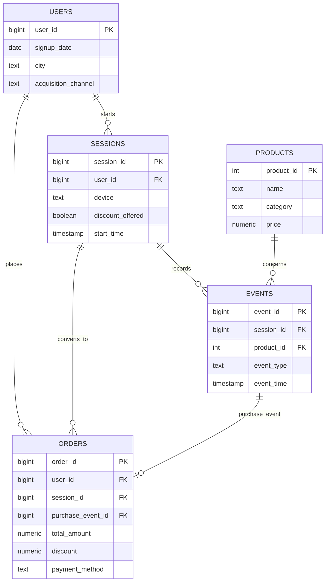

# Entity relationship diagram

`orders.purchase_event_id` connects a successful order to the corresponding purchase event. `discount_offered` belongs to a session because exposure must be available for both converting and non-converting sessions.
